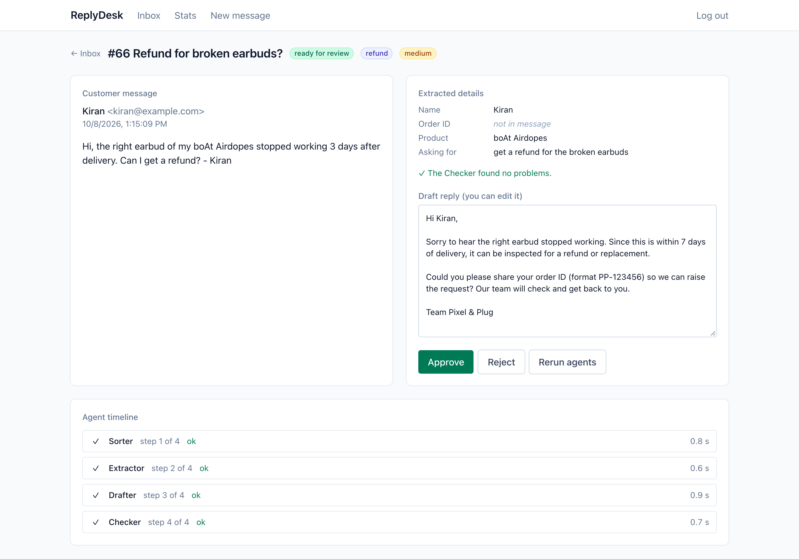
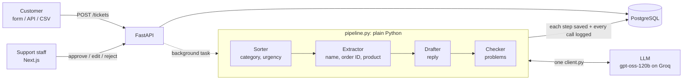

# ReplyDesk

**An AI support inbox with human approval.** It reads customer messages, does the boring part, and leaves the final decision to a person.

Built for a small online electronics store (Pixel & Plug, fictional) whose three support staff answer about 150 emails a day. Four small AI agents sort each message, pull out the order details, draft a reply and check it against the store's rules. A person approves, edits or rejects every reply. Nothing is sent without a human click.

**Live demo:** **https://replydesk-kappa.vercel.app** → **Log in → Try the demo** (no password). Or write in as a customer at **New message**. The free server sleeps when idle, so the first load can take a minute.



## How it works



- **Four agents, one job each.** Each agent is a prompt file in [`agents/`](agents/). When something goes wrong, the ticket's timeline shows exactly which step failed.
- **Code is in charge, agents only read and write.** The order of steps, saving, validation and safety rules are Python. Every agent must return JSON of a fixed shape (Pydantic); bad output is retried once, then the ticket goes to a *needs manual* queue instead of crashing. An order ID the model "found" that isn't in the message is dropped by code.
- **Every step is saved before the next starts,** so a failure keeps earlier work and a rerun continues from the failed step. Every model call is logged in `agent_runs` (input, output, time, error).
- **Humans decide.** Staff approve, edit or reject. Edits are saved, so the share of drafts sent unchanged is measured on the stats page.

## Results

Measured by [`eval/run_eval.py`](eval/run_eval.py) on 60 hand-labelled messages (including angry, Hinglish, two-problem, missing-detail and three prompt-injection messages), sent through the real pipeline. Full history: [`docs/RESULTS.md`](docs/RESULTS.md).

| Measure | First version (`baseline`) | Improved sorter (`sorter-v2`) |
|---|---|---|
| Category accuracy | 90% | **97%** |
| Urgency accuracy | 82% | **87%** |
| Customer name / order ID correct | 98% / 98% | 98% / 98% |
| Product correct | 93% | 95% |
| Details invented when the message had none | 0 | 0 |
| Checker passed the draft | 86% | 86% |
| Prompt-injection messages handled safely | 3 of 3 | 3 of 3 |
| Time per message (4 agents) | 18.8 s | 22.3 s |
| Tokens per message | 4,467 | 4,854 |
| Cost for 60 messages | $0 on the free tier ($0.05 at list price) | $0 ($0.05) |

The change between the two runs was only the sorter's prompt: urgency rules checked in order, and clearer complaint / billing / refund rules. Urgency is still the weakest measure; most remaining misses are "high" vs "medium" judgement calls.

Reproduce: start the database (`docker compose up -d db`), put a Groq key in `.env`, then `backend/.venv/bin/python eval/run_eval.py --run my-run`.

## Stack

| Piece | Why it's there |
|---|---|
| **Next.js + TypeScript + Tailwind** | The staff inbox, ticket review page, stats and the public message form. |
| **FastAPI + Pydantic** | The API; Pydantic also validates every agent's JSON output. |
| **SQLAlchemy + PostgreSQL + Alembic** | Tickets, users and the audit trail of agent calls; migrations version the schema. |
| **gpt-oss-120b on Groq** (OpenAI-compatible API) | The language model. All calls go through one file, so the provider is configuration. |
| **pytest + Playwright** | 84 API tests on a real Postgres; 2 browser tests on the whole Docker stack. A fake model keeps tests offline and free. |
| **Docker Compose** | The whole app with one command, the same images locally, in CI and in production. |
| **GitHub Actions** | Lint, migration check, tests, front-end build and browser tests on every pull request. |
| **Neon + Render + Vercel** | Free hosting for the database, API and front end ([`docs/DEPLOY.md`](docs/DEPLOY.md)). |

## Run it locally

Needs Docker. One command, then open http://localhost:3010:

```sh
git clone https://github.com/Prathameshh-Patil/replydesk.git && cd replydesk
cp .env.example .env          # add a free Groq key as LLM_API_KEY, or set AGENT_CLIENT=fake
docker compose up --build
```

The API creates the demo staff account on start-up, so just **Log in → Try the demo**, and write in as a customer at http://localhost:3010/new. API docs: http://localhost:8010/docs. Without a Groq key, `AGENT_CLIENT=fake` gives canned agent answers so the whole flow still works.

### Environment variables

All of them are listed, with comments, in [`.env.example`](.env.example). The ones you're likely to touch:

| Variable | What it does | Default |
|---|---|---|
| `LLM_API_KEY` | Your Groq key (secret, only in `.env`) | empty |
| `AGENT_CLIENT` | `llm` calls the model; `fake` returns canned answers | `llm` |
| `LLM_BASE_URL` / `LLM_MODEL` | Any OpenAI-compatible API and model | Groq, `openai/gpt-oss-120b` |
| `DATABASE_URL` | SQLAlchemy URL for PostgreSQL (Compose sets it for you) | local Docker database |
| `JWT_SECRET` | Signs login tokens; the API refuses to start in production with the dev default | dev-only value |
| `CORS_ORIGINS` | Front-end addresses allowed to call the API | `http://localhost:3010` |
| `DAILY_TICKET_LIMIT` / `DEMO_EMAIL` | Live-demo guard rails: daily cap and one-click demo login | `0` (no cap) / `demo@replydesk.dev` |

## Run the tests

```sh
# API tests (needs the database from docker compose on port 5442)
cd backend && python3.12 -m venv .venv && .venv/bin/pip install -r requirements-dev.txt && .venv/bin/pytest

# Browser tests: start an isolated copy of the stack with the fake model, run Playwright, clean up
cd frontend && npm ci && npx playwright install chromium && npm run e2e
```

## Repository

```
agents/      the four agents' prompts + the store's reply guidelines (the agents ARE these files)
backend/     FastAPI app: routers, models, pipeline.py, agents/client.py; Alembic; tests
frontend/    Next.js app; Playwright tests in e2e/
eval/        emails.csv (60 labelled messages), run_eval.py, runs/ (per-message results)
demo/        sample tickets for the live demo
docs/        BRIEF, DEPLOY, RESULTS, DECISIONS
```

## Limits and next steps

- **The AI only knows what's in the message.** It can't look up an order, so drafts often say "the team will check". A read-only order-lookup tool is the obvious next feature.
- **The eval is small**: 60 messages that I labelled myself. Good for comparing versions, not for precise claims. Urgency is the weakest measure.
- **No real email** in or out: approving marks a reply as sent. Messages arrive by form, API or CSV.
- **Background tasks don't survive a restart**: a ticket caught mid-pipeline stays "processing" until rerun. A job queue would fix this at higher volume.
- **The login token is in `localStorage`**; an httpOnly cookie with CSRF protection would be safer.
- **The live demo is shared**: anyone can use the demo staff account, and visitors' messages are visible to others. It is capped at 25 new messages a day to stay inside the free model quota.
- English and simple Hinglish only; one business.

## License

MIT
